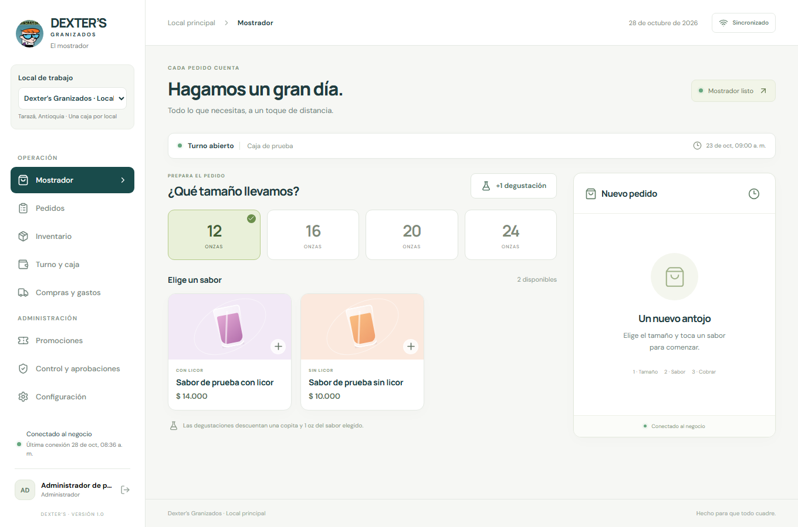
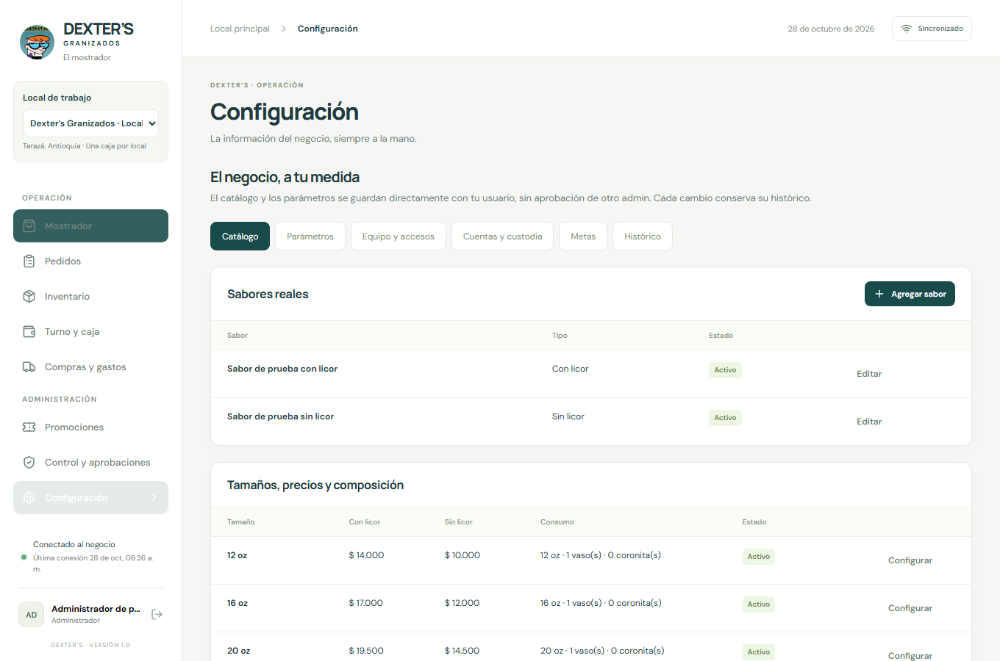
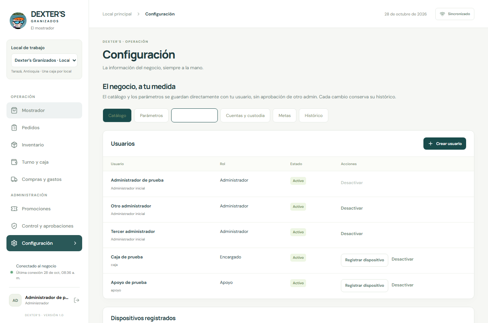
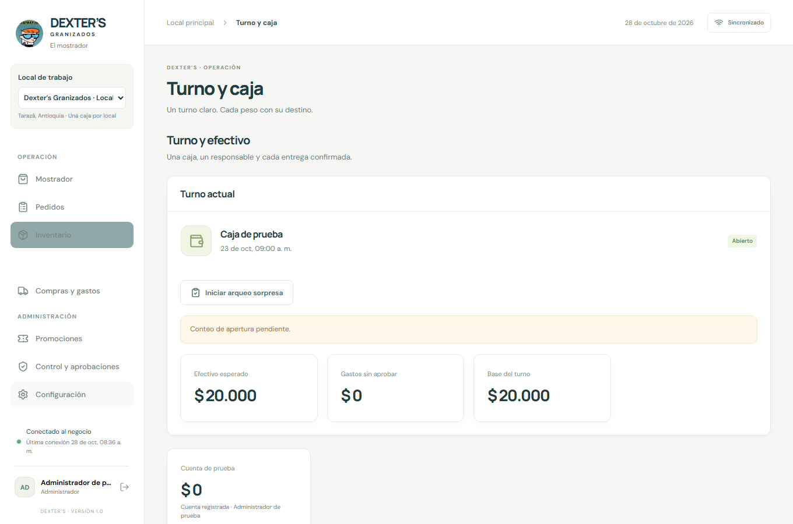
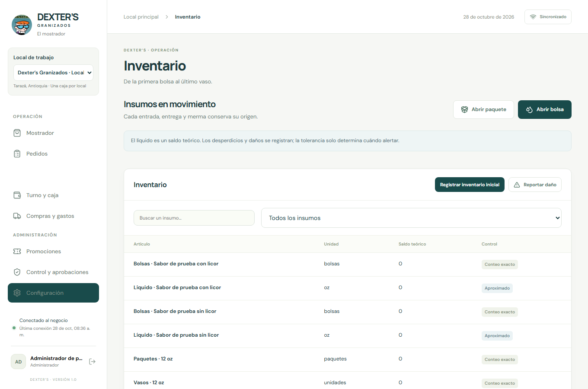

# Manual de usuario para administradores y empleados

Dexter’s Granizados

Guía de operación de locales para administradores propietarios encargados de caja y apoyo de mostrador

Versión del manual 2 | 13 de noviembre de 2026

Esta versión describe los ajustes preparados en el repositorio. Su aplicación al servicio publicado requiere la migración y actualización indicadas en [la guía de aplicación](../AJUSTES-OPERATIVOS.md).

Este manual explica cómo preparar un local, atender pedidos, registrar entregas y cobros, controlar mercancía y cerrar la jornada. También enseña a revisar novedades y a conservar la información cuando se pierde la conexión. Sigue el procedimiento correspondiente a tu rol y comprueba siempre el local y el turno antes de registrar una operación.

La aplicación se abre en https://dexter-granizados.vercel.app. Los importes se registran en pesos colombianos enteros y las horas de los formularios se interpretan en horario de Colombia. Los ejemplos de dinero de esta guía sirven para explicar los procedimientos; los valores de venta son los que muestre tu local.

## 1 Cómo usar este manual y reconocer tu rol

La aplicación tiene tres roles de operación. El propietario utiliza una cuenta de administrador y, además, tiene acceso a la gestión de los locales de su negocio. El acceso privado de superadministrador se explica en un manual independiente.

| Actividad                                      | Administrador                                                         | Encargado de caja                            | Apoyo de mostrador  |
| ---------------------------------------------- | --------------------------------------------------------------------- | -------------------------------------------- | ------------------- |
| Crear pedidos y registrar entregas             | Sí con turno disponible                                               | Sí                                           | Sí con conexión     |
| Cobrar pedidos                                 | Solo su propio turno conectado                                        | Solo su turno y equipo principal             | No                  |
| Abrir caja                                     | Inicia su propia caja conectado o autoriza la solicitud del encargado | Solicita apertura desde el equipo principal  | No                  |
| Presentar apertura y cierre                    | Cuando es responsable del turno                                       | Cuando es responsable del turno              | No                  |
| Solicitar arqueo y seleccionar ítems           | Sí con conexión y doble factor                                        | No                                           | No                  |
| Presentar conteo de arqueo                     | Cuando es responsable del turno                                       | Cuando es responsable del turno              | No                  |
| Abrir bolsas y paquetes y reportar daños       | Sí durante la operación                                               | Sí durante la operación                      | Sí con conexión     |
| Registrar recepción física de mercancía        | Sí                                                                    | Sí                                           | Sí con conexión     |
| Registrar gastos y movimientos de dinero       | Según origen y responsabilidad de caja                                | Según permisos y límites de caja             | No                  |
| Ver saldos teóricos y revisar diferencias      | Sí                                                                    | Conteos propios sin esperados ni diferencias | Sin saldos teóricos |
| Configurar catálogo promociones equipo y metas | Sí con conexión y doble factor                                        | No                                           | No                  |
| Solicitar locales y consultar mensualidades    | Solo si es propietario                                                | No                                           | No                  |

Si eres encargado de caja, comienza por acceso, apertura, pedidos, inventario, recepción, cierre y sincronización. Si eres apoyo, lee acceso, pedidos, entregas, degustaciones, inventario y recepción. Si eres administrador, revisa el manual completo antes de preparar el primer turno.

Los botones pueden aparecer ocultos o deshabilitados cuando el rol, el dispositivo, el turno o la conexión no permiten la acción. Tener rol de administrador no convierte a una persona en responsable del turno de otro usuario.

En **Configuración → Equipo y accesos**, el administrador dispone de una **Guía de perfiles y permisos**. Para cada trabajador puede pulsar **Editar permisos** y habilitar o restringir pedidos, entregas/degustaciones, inventario y, según su perfil, cobros, gastos, movimientos y apertura/cierre de caja. El apoyo nunca cobra ni mueve dinero, aunque se intente habilitar ese permiso. Los administradores conservan sus facultades administrativas. Los permisos son propios de cada usuario y local y se validan también en el servidor.

## 2 Ingreso y protección de la cuenta

### Ingreso de un administrador

1. Abre la aplicación y pulsa **Administrador**.
2. Escribe tu correo electrónico y contraseña y pulsa **Continuar**.
3. Completa el doble factor con el código de tu aplicación de autenticación. Si es tu primer acceso, sigue la configuración que muestra la pantalla y guarda el acceso a tu autenticador.
4. Si aparece **Registrar este equipo**, escribe un nombre que permita identificar el navegador. Configura el PIN local de respaldo si la pantalla lo solicita y corresponde a la operación prevista.
5. Comprueba el usuario, el local seleccionado y el estado de conexión antes de trabajar.

La contraseña de las cuentas nuevas debe tener entre 14 y 200 caracteres. El código de doble factor y el PIN del empleado cumplen funciones diferentes; introducir uno en el campo del otro no inicia sesión.

**Primera cuenta del negocio.** La opción **Configurar primer administrador** se usa una sola vez en la instalación inicial y exige el código privado de configuración entregado por el responsable de la aplicación. No sirve para crear un local adicional. Los demás usuarios se crean desde Configuración.

### Ingreso de un empleado

1. Pide al administrador tu usuario y PIN de seis dígitos.
2. En el acceso de empleados, escribe ambos datos.
3. En el primer ingreso del equipo, introduce también el código de registro entregado por el administrador y un nombre reconocible para el dispositivo.
4. Pulsa **Continuar**. El código de registro vence a los 15 minutos y se utiliza una sola vez.
5. En ingresos posteriores desde ese navegador utiliza tu usuario y PIN, conservando los datos del navegador.

El administrador decide si el equipo registrado será la caja principal del local. El teléfono de apoyo no obtiene permiso para cobrar por el hecho de poder crear pedidos. Si el código venció o el equipo perdió su registro, solicita otro; no pruebes códigos al azar, porque existen límites de intentos.

### Recuperación y cambio de usuario

En **Administrador → Olvidé mi contraseña**, escribe el correo y solicita el enlace. También puedes abrir **Recuperar mi contraseña** desde el botón del perfil cuando tienes una sesión administrativa abierta. En el enlace de recuperación, verifica el doble factor si ya estaba configurado, elige una contraseña nueva y confírmala. Un enlace vencido permite solicitar otro.

La recepción del correo depende del servicio de correo configurado. Si no llega, revisa spam y comunica el caso al desarrollador. Recuperar la contraseña no elimina el doble factor. Si perdiste el autenticador, informa al responsable del servicio; este formulario no es un mecanismo para omitirlo.

El empleado que olvida su PIN debe acudir al administrador o al responsable técnico; la recuperación por correo de administrador no es su método de acceso. La pantalla de equipo permite crear cuentas y activar o desactivar accesos; no debe asumirse que cualquier función técnica de restablecimiento está disponible como botón en esa pantalla.

Para salir, pulsa tu perfil y confirma el cambio de usuario. Si hay registros pendientes, permanecen en ese navegador y deben sincronizarse al volver con el mismo usuario. Salir de la sesión no equivale a cerrar la caja.

## 3 Pantallas y selección del local

En escritorio, el menú está a la izquierda. En un teléfono, pulsa el botón de menú para abrirlo. Algunas tablas permiten desplazamiento horizontal para ver las últimas columnas.

| Pantalla                | Para qué se utiliza                                                                                            |
| ----------------------- | -------------------------------------------------------------------------------------------------------------- |
| Mostrador               | Preparar pedidos degustaciones entregas y cobros autorizados                                                   |
| Pedidos                 | Buscar y revisar tickets entregar pendientes tramitar anulaciones e ingresar planillas cuando se tiene permiso |
| Inventario              | Abrir bolsas y paquetes registrar daños y consultar el control disponible para tu rol                          |
| Turno y caja            | Solicitar o iniciar turnos contar efectivo cerrar caja y registrar movimientos de dinero autorizados           |
| Compras y gastos        | Crear compras y envíos recibir mercancía y registrar gastos permitidos                                         |
| Promociones             | Crear beneficios y emitir cupones con cuenta administrativa                                                    |
| Control y aprobaciones  | Revisar solicitudes diferencias avisos auditoría y exportar información con cuenta administrativa              |
| Configuración           | Administrar catálogo parámetros usuarios dispositivos destinos de dinero metas e histórico                     |
| Locales y mensualidades | Solicitudes y consulta del propietario o gestión del desarrollador                                             |

En **Local de trabajo**, verifica el nombre antes de registrar pedidos o dinero. Cada local conserva sus datos de operación por separado y admite una caja operativa a la vez. Una cuenta propietaria puede ver varios locales; los empleados y administradores adicionales ven los que les correspondan.

Cambiar de local exige conexión, que termine la sincronización y que no queden conflictos ni fotografías pendientes de tu usuario. Las pestañas conservan su selección de local de manera independiente; verifica la selección en cada una. En un local pendiente, suspendido o archivado puedes consultar la información a la que tengas acceso, pero no registrar operación.

El indicador superior de sincronización permite distinguir lo guardado en el servidor de lo que todavía está en el navegador. Ábrelo cuando haya un aviso, una espera o una fotografía pendiente.

## 4 Preparación inicial por el administrador

Prepara el local antes de permitir ventas: revisa catálogo y precios, parámetros, personal, dispositivo principal, destinos de dinero e inventario inicial. Cada local nuevo comienza con operación vacía; no se copian las ventas ni existencias de otro local.

### Sabores y presentaciones

El mostrador muestra las fotos disponibles, ordena los sabores alfabéticamente y permite filtrar **Todos**, **Sin licor** o **Con licor** antes de seleccionar el producto.

1. Entra en **Configuración → Catálogo**.
2. Pulsa **Agregar sabor**, escribe el nombre, adjunta su imagen e indica si lleva licor y si está disponible. Guarda. Al editar puedes reemplazar la imagen o marcar **Quitar imagen actual**; dejar el archivo vacío conserva la foto anterior.
3. En la presentación que necesites, pulsa **Configurar** y revisa precio con licor y sin licor, onzas, vasos y coronitas consumidos por unidad, y disponibilidad.
4. Revisa el resultado en Mostrador. Un sabor o tamaño inactivo no se ofrece para una venta nueva.

Los tamaños base incluyen 12, 16, 20 y 24 oz. La presentación Nevera 3 litros comienza inactiva y requiere completar su configuración antes de venderla. Usa las presentaciones y campos que ofrece el catálogo; el manual no presupone un botón para crear tamaños arbitrarios.

Las onzas y los consumos físicos deben representar el producto real: si se configura una receta equivocada, el inventario teórico se desviará aunque la venta tenga el precio correcto. Los cambios quedan en el histórico y no reescriben los tickets ya registrados.

### Parámetros de operación

En **Configuración → Parámetros**, completa los campos y pulsa **Publicar configuración**. Los cambios administrativos se guardan con tu identidad sin esperar aprobación de otro administrador.

| Parámetro                                  | Uso práctico                                                           |
| ------------------------------------------ | ---------------------------------------------------------------------- |
| Nombre del negocio                         | Identifica la operación en el contexto del local                       |
| Tope de efectivo por caja                  | Genera control sobre la acumulación de dinero                          |
| Tope de un gasto pagado desde caja         | Limita los gastos que se pueden registrar con ese origen               |
| Categorías permitidas desde caja           | Define qué conceptos pueden pagarse desde la caja                      |
| Cortesías por admin al mes                 | Controla la cuota de emisión marcada como cortesía                     |
| Vasos por paquete y onzas por bolsa        | Referencias para registrar la apertura de insumos                      |
| Tolerancia de líquido                      | Determina alertas de pérdida estimada y no descuentos automáticos      |
| Aviso tras minutos sin sincronizar         | Señala cuánto tiempo lleva el equipo sin actualizar                    |
| Omitir conteo de apertura por contingencia | Permite dejarlo pendiente si el negocio habilita esa excepción         |
| Línea base                                 | Identifica la etapa de medición del consumo de líquido                 |
| Checklist de apertura y cierre             | Una tarea por línea que el responsable confirma al presentar el conteo |

Mientras se mide la línea base, la tolerancia puede permanecer sin configurar. Los cambios de parámetros y listas de chequeo conservan la versión utilizada en los registros anteriores.

### Metas e histórico

En **Configuración → Metas**, registra una meta semanal o mensual, su intervalo, meta en vasos y meta en pesos. Consulta los valores y avances que presenta la aplicación; una meta no cambia precios ni genera un movimiento de efectivo.

En **Configuración → Histórico**, consulta las versiones y responsables de cambios. Utiliza este registro para explicar una diferencia entre una venta pasada y el precio actual, en lugar de modificar la venta anterior.

## 5 Usuarios dispositivos y custodia de dinero

### Crear un usuario

1. Selecciona el local correcto y abre **Configuración → Equipo y accesos → Crear usuario**.
2. Escribe nombre y usuario en minúsculas sin espacios. El usuario admite letras, números, puntos y guiones.
3. Selecciona **Administrador**, **Encargado de caja** o **Apoyo** según el trabajo real de la persona.
4. Para un empleado, asigna un PIN de seis dígitos. Para otro administrador, completa correo y contraseña de al menos 14 caracteres.
5. Guarda y verifica su aparición en la lista. La cuenta del equipo queda asignada al local donde la creaste.

El propietario conserva acceso administrativo a los locales de su negocio. Crear empleados o administradores adicionales no los convierte en propietarios ni les concede acceso privado de superadministrador.

### Registrar y cambiar el equipo principal

En el empleado activo, pulsa **Registrar dispositivo**, indica si será el equipo principal y entrega el código temporal a esa persona. El empleado lo consume al ingresar desde el dispositivo que utilizará.

La sección **Dispositivos registrados** permite revisar nombres, usuarios, tipo de acceso y actividad. **Hacer principal** cambia el equipo de caja del local. Antes de cambiarlo, cierra y sincroniza el turno; el sistema bloquea el cambio cuando hay un turno solicitado, abierto o provisional.

Puedes activar o desactivar usuarios y equipos cuando el botón esté disponible. La aplicación protege el acceso propio, el propietario, el último administrador y la identidad privada del desarrollador. Desactivar un acceso no borra ventas o auditoría. Un equipo desconectado recibe la revocación al volver a conectarse; conserva cualquier registro pendiente para revisión.

### Registrar cajas y cuentas receptoras

En **Configuración → Cuentas y custodia → Registrar destino**, escribe nombre, tipo —cuenta bancaria o caja principal en custodia—, administrador que recibe, banco y cuenta si corresponde, saldo inicial y estado activo. Usa un saldo inicial real del dinero del negocio bajo esa custodia.

Un destino es una ubicación del dinero y no una sucursal. Registrar una cuenta personal de un administrador como destino significa controlar dinero del negocio bajo su custodia; no transforma una consignación en utilidad ni crea una integración bancaria automática.

## 6 Apertura del turno

### Apertura por el encargado

1. Ingresa con tu usuario desde el equipo principal del local y abre **Turno y caja**.
2. Si no hay turno activo, pulsa **Solicitar turno**.
3. Un administrador conectado revisa la solicitud y pulsa **Autorizar apertura**, indicando la base inicial cuando corresponda.
4. Con el turno abierto, el responsable pulsa **Contar apertura**, completa la lista de chequeo y registra efectivo y artículos físicos.
5. Pulsa **Registrar conteo** y comprueba que el turno corresponde a tu usuario.

### Apertura por un administrador que atenderá caja

Con conexión y doble factor, abre **Turno y caja → Iniciar caja**, indica la base y confirma. El turno queda a tu nombre y autorizado por ti; presenta después el conteo de apertura. No necesitas la autorización de otro administrador para iniciar tu propio turno.

Si existe efectivo físico anterior registrado, la aplicación utiliza ese saldo para la apertura en lugar de reemplazarlo libremente. Si ya hay un turno solicitado, abierto o provisional del local, resuélvelo o ciérralo antes de abrir otro.

Los conteos se presentan a ciegas: introduce lo que contaste físicamente antes de comparar con el sistema. No copies una cifra esperada para eliminar una diferencia. El encargado consulta sus conteos originales, mientras el administrador revisa los valores esperados y las diferencias.

Si el negocio habilitó **Omitir por contingencia y dejar pendiente**, la opción aparece en la apertura. Utilízala solo cuando corresponda y deja la novedad; no implica que se haya presentado el conteo.

## 7 Pedidos entregas y cobros

### Crear y completar un pedido

1. Entra en **Mostrador** y verifica que existe un turno abierto.
2. Selecciona la presentación y el sabor. Al agregar un producto se crea o se actualiza el pedido activo.
3. Ajusta las unidades con los controles de cantidad y revisa cada línea, el total y los beneficios que aparezcan.
4. Utiliza la selección de pedidos abiertos o **Guardar y abrir otro pedido** para atender otro cliente sin mezclar sus productos con el pedido anterior.
5. Antes de cobrar, confirma que estás viendo el ticket correcto.

El apoyo puede registrar pedidos para que el encargado los cobre. Un pedido abierto representa una atención en curso; no debe interpretarse como dinero recibido. Los productos entregados y los pagos tienen registros distintos.

### Entrega parcial y entrega posterior al cobro

En la línea del pedido, el contador de entregados permite registrar una unidad entregada. Si se solicitaron tres productos y solo entregaste uno, registra esa unidad y deja dos pendientes. No marques lo que aún no se ha entregado físicamente.

En **Pedidos**, el botón **Entregar pendientes** registra las unidades faltantes del ticket. Revisa que realmente se hayan entregado todas antes de usarlo. La aplicación permite un pedido cobrado con productos pendientes de entrega y también productos entregados antes del pago; cada situación requiere completar el paso faltante.

El consumo del producto entregado descuenta los insumos de su receta. Crear un pedido por sí solo no equivale a entregar toda la mercancía. Una corrección de ticket debe indicar si se trata del mismo producto físico para evitar duplicar el consumo.

### Cobro rápido

El responsable del turno utiliza **Cobrar y entregar** cuando recibe el dinero y entrega todo lo pendiente en ese momento. Comprueba el total, recibe el pago real, confirma una sola vez y revisa el mensaje de venta registrada.

El rol de administrador solo puede cobrar su propio turno conectado. El encargado cobra su turno desde el equipo principal asociado. El apoyo no cobra y otro administrador no puede cobrar el turno de un compañero por tener permisos de configuración.

### Cobro con cupón vuelto o entrega pendiente

1. En el pedido, pulsa **Cupón, cortesía, vuelto o entregar después**.
2. Si hay un cupón, escribe el código o pulsa el lector QR y autoriza la cámara. Pulsa **Validar** y verifica el total recalculado. Se necesita conexión.
3. Si deseas calcular el vuelto, indica el efectivo recibido. Este campo ayuda a calcularlo; el registro sigue siendo un cobro en efectivo.
4. Revisa si se entregará lo pendiente al confirmar y cambia esa opción cuando la entrega vaya a ser posterior.
5. Confirma el cobro y comprueba el resultado en Pedidos.

Validar un cupón no lo consume todavía: se consume al confirmar el cobro aceptado. No se puede reutilizar un código ya canjeado ni utilizar uno vencido o que no corresponda a los productos. La pantalla de cobro admite hasta diez códigos por pedido y el sistema determina cuáles beneficios son aplicables.

**Ejemplo.** El total es $34.000 y recibes $50.000; el vuelto es $16.000. Si entregas solo una parte, deja correctamente registrados los pendientes. El estado pagado no demuestra que ya se entregó todo.

El medio de pago se selecciona antes de cobrar: **Efectivo**, **Nequi** u otra cuenta receptora configurada. Para habilitar Nequi, el administrador entra en **Configuración → Cuentas y custodia → Configurar Nequi**, indica el número receptor, el responsable de la cuenta y el saldo inicial que corresponda. La opción queda habilitada para recibir ventas. Sin una cuenta activa configurada para ventas, el botón Nequi permanece deshabilitado. Al seleccionar Nequi se muestra el destino y puede anotarse un comprobante opcional; confirma el cobro cuando hayas verificado que el pago llegó. El registro conserva la cuenta y el comprobante, y ese ingreso se muestra por transferencia, separado del efectivo de caja. Registrar el pago no consulta automáticamente Nequi ni inicia una transferencia.

### Degustaciones y cambios antes del cobro

Para un combinado o bomba, elige el tamaño y pulsa **Combinado / bomba**. Toca los sabores que echaste, revisa las porciones y pulsa **Agregar combinado**. Se registra un solo vaso y las onzas se dividen en partes iguales: 16 oz con dos sabores son 8 oz de cada uno; con tres, 5⅓ oz de cada uno. La pantalla aproxima los decimales para lectura, pero el inventario conserva el reparto sin redondear. Si cualquiera de los sabores lleva licor, se cobra la tarifa con licor del tamaño. Para un vaso sin mezcla usa **Un sabor**. Las porciones quedan visibles en Mostrador, Pedidos y el detalle del ticket, y se descuentan al entregar. Si una promoción limita los sabores, todos los de la mezcla deben estar incluidos. Al corregir tickets o ingresar planillas, el selector de sabor también permite **Combinado / bomba**.

Registra la degustación con el sabor correspondiente desde Mostrador. Cada degustación descuenta una onza y una copita. Un pedido con solo degustaciones puede finalizarse sin venta; no se debe simular un cobro para cerrarlo.

Si registraste una degustación de prueba o por error, usa la papelera de esa degustación para eliminarla. Se restituyen una copita y una onza del sabor registrado. Para cambiar el sabor, selecciónalo en la misma fila: se devuelve la onza del sabor anterior y se descuenta del nuevo, conservando una sola copita. También puedes hacerlo desde el detalle del ticket en **Pedidos**, incluso cuando quedó como **Solo degustaciones**. Si eliminas la última degustación de un pedido sin productos, queda cancelado; en un ticket vendido se mantienen su cobro y sus productos. Las correcciones conservan los movimientos anteriores y agregan el ajuste al historial. El personal corrige degustaciones del turno activo; los turnos anteriores los corrige un administrador. Durante un arqueo, espera a finalizarlo. Las correcciones sin conexión se guardan desde el equipo principal y se sincronizan al reconectar.

Antes del cobro puedes ajustar las cantidades disponibles con los controles de la línea, conservando lo ya entregado. Si no has cobrado ni entregado productos, pulsa **Cancelar pedido** en Mostrador; también puedes reducir a cero el último producto. El pedido sale de los pendientes y queda en el historial. Si tenía degustaciones, estas y su consumo se conservan y el registro queda como **Solo degustaciones**. Los tickets sustitutos de una venta anulada deben finalizar su corrección y no ofrecen esta cancelación. **Guardar y abrir otro pedido** conserva el actual; no lo cancela. Si ya hubo entrega física, completa el cobro o registra la novedad de pedido sin pagar o la anulación según su estado.

## 8 Consultar y corregir tickets

En **Pedidos**, utiliza los filtros disponibles y abre el número del ticket para ver productos, entregas, estado y datos asociados. El acceso del empleado se limita a los pedidos del turno activo o los vinculados a su usuario; el administrador revisa el historial del local.

### Venta cobrada con un error

1. En el ticket pagado, pulsa **Solicitar anulación**.
2. Describe el motivo y adjunta la fotografía de soporte.
3. Un administrador que no haya participado en la venta ni en su cobro revisa la solicitud en **Control y aprobaciones**.
4. Si la anulación se aprueba, el responsable autorizado de caja utiliza **Corregir ticket** para crear el sustituto o **Reembolsar** para un reembolso completo, según lo ocurrido.
5. Revisa el vínculo entre tickets, el dinero que falta recibir o devolver y las entregas.

La aprobación de la anulación no registra por sí sola un reembolso ni crea el ticket correcto. El registro original se conserva. Si se rechaza la solicitud, la venta mantiene su condición de pagada.

Al crear el sustituto, marca **Es el mismo producto físico ya entregado** solo si estás corrigiendo el registro de esa misma entrega. Si se preparará un producto nuevo, el consumo anterior se conserva y el nuevo producto descontará insumos al entregarse. Un ticket con cupón tiene reglas adicionales para conservar un beneficio válido y requiere conexión cuando corresponda.

El pago anterior se aplica al ticket sustituto. Si el correcto vale más, recibe la diferencia; si vale menos, devuelve la diferencia y adjunta el soporte solicitado. Para un reembolso completo, adjunta el comprobante y verifica que el ticket esté anulado, pendiente de resolución y dentro de las condiciones del turno que permite la aplicación.

**Ejemplo.** Se cobraron $20.000 y el ticket correcto es de $17.000. El pago anterior se vincula y corresponde devolver $3.000 con evidencia. Registrar otra venta de $17.000 y dejar intacta la anterior duplicaría la venta.

### Cliente que recibió y no pagó

Si un pedido abierto tiene entregas y el cliente no paga, el responsable de caja utiliza **No se pagó**, describe lo ocurrido y conserva la novedad. Este registro no debe usarse para corregir una venta que sí fue pagada.

### Ingresar ventas de una planilla

El administrador utiliza **Ingresar desde papel** desde Pedidos cuando debe incorporar una operación real registrada en una planilla. Selecciona turno, folio único, hora original de Colombia, foto de la planilla, productos, cantidades, condición de entrega y novedades. Verifica los importes y confirma.

Cada folio es único dentro del local y la hora original debe ser válida. La aplicación conserva el origen en papel y la conciliación; no modifica un conteo ya presentado. Termina un arqueo activo antes de ingresar sus ventas de planilla. No dupliques en planilla una venta que ya está pendiente de sincronización en el navegador.

## 9 Inventario bolsas paquetes y desperdicios

### Inventario inicial

El administrador abre **Inventario → Registrar inventario inicial** e introduce las cantidades que desea agregar en su unidad. El botón permanece disponible después de cada registro: las cantidades se suman al saldo existente y los artículos en cero conservan su saldo. Los consumos se registran mediante las operaciones de la aplicación.

Verifica las diferencias entre bolsas selladas, líquido en onzas, paquetes completos y vasos sueltos. Registrar la misma existencia como paquete cerrado y también como todos sus vasos sueltos duplicaría lo disponible.

### Abrir un paquete de vasos

1. Abre **Inventario → Abrir paquete**.
2. Selecciona la presentación e indica las unidades reales del paquete.
3. Si existe uno anterior abierto, confirma que quedó vacío solo después de comprobarlo físicamente.
4. Guarda y verifica su aparición entre los paquetes abiertos.

Abrir un paquete descuenta un paquete cerrado y agrega sus vasos sueltos. Si se declara vacío el anterior cuando todavía se esperaba un saldo, se conserva la diferencia para revisión.

### Abrir y agotar una bolsa

Pulsa **Abrir bolsa**, elige sabor e indica las onzas correspondientes. Se descuenta una bolsa sellada y se incorpora el líquido de referencia. Cuando la bolsa realmente termine, usa **Marcar agotada** en la lista de bolsas abiertas.

El saldo de líquido es teórico. Se calcula a partir de lo abierto, servido, degustado y las pérdidas aprobadas. El residual se estima cuando se han agotado todas las bolsas abiertas de ese sabor; mientras tanto puede aparecer **Pendiente de agotar bolsas**.

### Reportar daño o desperdicio

Desde **Reportar daño**, elige artículo, cantidad y motivo y adjunta fotografía. Para bolsas, completa la verificación y el diagnóstico cuando corresponda. Los artículos físicos se registran en unidades enteras; el líquido utiliza onzas.

El reporte genera una solicitud para revisión. El administrador revisa el soporte y aprueba o rechaza; la merma de un reporte se descuenta al aprobarla. Un artículo que llegó dañado y ya se registró como tal en una recepción no debe descontarse de nuevo mediante otro reporte del mismo hecho.

El encargado y el apoyo no ven los saldos teóricos ni las diferencias reservadas para administración. El administrador puede buscar insumos, filtrar tipos, revisar saldos negativos y consultar **Líquido y pérdida aceptable**. Una tolerancia superada genera una alerta de control; no crea un cobro al empleado ni un descuento automático.

## 10 Compras recepción de mercancía y gastos

### Registrar una compra y envío

1. El administrador abre **Compras y gastos → Compra y envío**. Se abre el formulario Registrar compra y envío.
2. Escribe proveedor y elige el origen ofrecido por el formulario: **Medellín** o **Tarazá**. Son las opciones disponibles en esta versión.
3. Agrega artículos, cantidades y costos unitarios sin repetir el mismo artículo en varias líneas.
4. Si se registra un pago, indica el origen real: bolsillo del administrador, caja o cuenta del negocio, o caja del turno cuando esté autorizado.
5. Adjunta soporte y notas y guarda.

Registrar la compra declara lo enviado; no significa que el local ya lo haya recibido. Si se vinculó un gasto, revisa también su estado de aprobación.

### Recibir lo que realmente llegó

La recepción es a ciegas para el empleado: registra lo físico antes de ver el cruce contra lo enviado.

1. Abre el envío pendiente y pulsa **Recibir**.
2. En cada artículo recibido, escribe el **Total recibido** y cuántos de ese total llegaron dañados.
3. Deja en blanco los artículos que no llegaron en esta recepción. No confundas un campo vacío con una confirmación de recepción completa.
4. Adjunta la foto obligatoria del estado de la mercancía y observaciones.
5. Confirma. Se registra la recepción y se calcula el cruce; si falta parte de lo enviado, el envío queda parcial.

**Ejemplo.** Llegaron diez bolsas, dos dañadas: registra total 10 y dañadas 2, no total 8 y dañadas 2. La entrada utilizable es de ocho bolsas. En la siguiente llegada registra solo lo recibido en ese nuevo evento.

El administrador consulta las cantidades enviadas, recepciones, daños y diferencias. El empleado ve sus recepciones sin los esperados ni las diferencias de control. Una diferencia genera aviso para revisión; no debe corregirse inventando una segunda recepción.

### Registrar un gasto ya pagado

El encargado o el administrador pulsa **Registrar gasto**, selecciona categoría, monto, origen del dinero, proveedor y soporte o nota. Cuando se utiliza efectivo de caja se exige la responsabilidad del turno, una categoría permitida y que el monto no supere el tope configurado. El apoyo no registra gastos.

Usa fotografía del comprobante; si no tienes foto, agrega una nota explicativa. El administrador aprueba o rechaza el gasto desde su registro. El gasto queda pendiente de revisión y se descuenta del efectivo esperado cuando se aprueba. Conserva el soporte y no vuelvas a retirar o pagar dinero porque el gasto todavía esté pendiente.

Cuando un administrador pagó con su bolsillo, la aprobación puede generar el trámite de reembolso correspondiente. Ese trámite sigue las aprobaciones de salida por reembolso; aprobar el gasto no equivale a haberle entregado físicamente dinero.

## 11 Entregas consignaciones utilidades y reembolsos

En **Turno y caja → Entregas y consignaciones**, registra movimientos entre la caja y los destinos de dinero del local. El apoyo no mueve dinero. El encargado opera las salidas autorizadas de caja y el administrador dispone de los orígenes y tipos administrativos que muestra el formulario.

### Traslado dentro del negocio

1. Usa la acción de solicitar movimiento, elige el origen disponible, destino registrado, monto y concepto.
2. Verifica que el receptor sea una persona diferente de quien entrega.
3. Cuando se haga la entrega o consignación real, el emisor utiliza **Registrar entrega o consignación** y adjunta el comprobante exigido. El movimiento pasa a **En tránsito**.
4. El administrador receptor verifica el efectivo recibido o la cuenta bancaria y usa **Confirmar recepción**, indicando el monto real.
5. Si coincide, el movimiento queda confirmado. Si difiere, queda en disputa para revisión.

Solicitar un traslado no confirma que el dinero salió, y ejecutarlo no confirma que el receptor lo recibió. Las consignaciones se registran manualmente con evidencia; la aplicación no consulta el banco para validarlas.

### Utilidades y reembolso de gastos

Las salidas por utilidad y los reembolsos administrativos requieren **tres aprobaciones de administradores distintos** y evidencia. Cada persona vota una sola vez. Una vez completadas, otro administrador diferente del beneficiario registra la ejecución con el origen de dinero correspondiente.

Esta regla no se resuelve creando tres votos desde la misma cuenta ni usando el acceso privado del desarrollador como atajo. Si el negocio tiene menos personas autorizadas de las que exige la regla, debe organizar esos accesos antes de ejecutar esta clase de salida.

El reembolso de un ticket anulado al cliente es un procedimiento diferente, descrito en el capítulo de corrección de tickets. No uses una salida por utilidad para corregir un cobro del mostrador.

## 12 Promociones cupones y cortesías

Solo un administrador conectado configura promociones y emite cupones. Se guardan directamente con su identidad y se conserva el histórico.

### Generar una cortesía completa

1. En **Promociones**, pulsa **Generar cortesía**.
2. Define el nombre, el tamaño del vaso y si aplica con licor, sin licor o a ambos tipos. Puedes limitar los sabores y permitir o excluir combinados. Configura **Acumulable con otras cortesías en productos distintos** para decidir si puede combinarse con otros códigos en el mismo pedido.
3. Indica el vencimiento. Cada código cubre un vaso completo a **$0**, incluidos todos sus sabores y componentes; su emisión respeta la cuota de cortesías configurada.
4. Pulsa **Generar código de cortesía**. Se muestra el código con las condiciones y su QR; puedes copiar el código o compartirlo.
5. Caja agrega el producto autorizado al pedido, abre **Cupón, cortesía, vuelto o entregar después**, ingresa el código y pulsa **Validar**. Comprueba que el vaso completo quede sin cobro.
6. Pulsa **Registrar cortesía y entregar** al entregar físicamente el producto. No se registra ingreso de dinero y sí se descuenta la receta completa: vaso, onzas de cada sabor y los demás insumos configurados. Si se entregará después, desmarca la entrega y registra la cortesía; el consumo se registra cuando se entregue.

El código se consume al confirmar el registro, no al generarlo ni al validarlo. Un código usado o vencido no puede canjearse. Si el producto no corresponde al tamaño, tipo o sabores autorizados, se rechaza la cortesía. Los productos adicionales del pedido conservan su cobro; cada código cubre un vaso distinto. Las condiciones de una cortesía emitida se conservan; para ofrecer otro beneficio, genera otro código.

### Crear una promoción

1. Abre **Promociones → Crear promoción**.
2. En **Qué cambia**, elige precio fijo, subir uno o dos tamaños, lleva N y paga M, o producto gratis con cupón.
3. En **Cómo se entrega**, elige automática por horario o cupón de un solo uso. Un producto gratis requiere cupón.
4. Define nombre, inicio y final de vigencia, horario diario y días aplicables. Los días sin seleccionar representan todos.
5. Selecciona tipo de sabor, tamaños y sabores elegibles. Para un producto gratis debes seleccionar expresamente sus tamaños y sabores. En los otros efectos, dejar esos campos vacíos representa todos los productos elegibles al emitir el cupón.
6. Completa el valor del efecto y el límite global si lo habrá. Una promoción con límite global necesita conexión para aplicar su beneficio.
7. Configura **Acumulable con otras cortesías y promociones**: permite combinar beneficios en productos distintos; una misma unidad no recibe dos beneficios. Desmarcarlo hace que el sistema elija el beneficio exclusivo o la combinación permitida que más favorezca al pedido, sin consumir códigos no aplicados.
8. Pulsa **Publicar promoción** y revisa la tarjeta. Puedes editar, apagar o activar desde esa tarjeta.

Para lleva N y paga M, M debe ser menor que N; un ejemplo es lleva 3 y paga 2. En un upgrade selecciona uno o dos tamaños. Comprueba el total del pedido y los productos beneficiados; no sumes manualmente beneficios que el sistema no haya aplicado.

### Emitir y compartir un cupón

1. Pulsa **Emitir cupón** y selecciona una promoción activa que se entregue con cupón.
2. Indica vencimiento en hora de Colombia y si la emisión cuenta en tu cuota de cortesías.
3. Si agotaste la cuota, solicita **Cortesía adicional** con motivo y espera que otro administrador apruebe. Selecciona esa autorización al emitir.
4. Guarda y abre **Ver QR y compartir** en la lista.
5. Usa **Compartir código**, **Compartir QR** o **Descargar QR**. Si el navegador no admite compartir archivos, descarga el QR para enviarlo junto al texto y sus condiciones.

El cupón muestra código, beneficio, vencimiento y estado. El código no contiene datos personales. Compartirlo o visualizar su QR no equivale a canjearlo. El encargado lo valida con conexión durante el cobro y un código no puede consumirse dos veces.

Cada cupón nuevo conserva los tamaños, sabores, tipo de licor, beneficio, acumulación y horarios ofrecidos al emitirlo. Editar después la promoción no cambia ese producto prometido. La promoción debe seguir activa y respetar sus límites globales; el cupón mantiene su vencimiento. Los cupones anteriores a esta actualización conservan sus reglas anteriores.

### Canjear varias cortesías en un pedido

1. En Mostrador, prepara los productos y abre **Cupón, cortesía, vuelto o entregar después**.
2. Escribe el código o pulsa **Escanear cupón** para leer el QR con la cámara. Pulsa **Validar** después de cada código; admite hasta diez.
3. Revisa qué código cubre cada producto, la cantidad y el total realmente pendiente. Los códigos marcados **Sin usar** no se consumen.
4. Selecciona efectivo o la cuenta de transferencia para el saldo pendiente y confirma el cobro. El canje se confirma junto con la venta; validar o escanear no consume el cupón.

Tres personas pueden usar tres cortesías acumulables para tres granizados en la misma factura, con saldo cero y sin movimiento de dinero. Si hay dos granizados y una cortesía válida, esta cubre uno y el otro se paga en efectivo o transferencia. Si presentas tres cortesías para dos productos elegibles, solo se canjean dos; la tercera queda disponible hasta su vencimiento. No produce saldo a favor, efectivo ni vuelto. El historial de Pedidos conserva los códigos y las cantidades aplicadas a cada producto.

No agregues cortesías a un ticket de corrección que ya arrastra un pago anterior: el sistema lo impide para evitar convertir beneficios en devoluciones. Las correcciones que conservan cupones originales mantienen su trazabilidad y no los canjean de nuevo.

## 13 Control aprobaciones y arqueos

### Resolver solicitudes

En **Control y aprobaciones**, filtra pendientes o todas. Abre las evidencias y comprueba tipo, motivo, usuario, pedido o artículo afectado antes de **Aprobar** o **Rechazar**.

Las solicitudes incluyen anulaciones, daños o desperdicios, explicaciones de diferencias, pedidos sin pagar, cortesías adicionales y conflictos de sincronización. Una anulación no puede ser aprobada por el vendedor ni por quien cobró esa venta. La cortesía adicional requiere una persona distinta del solicitante. Los demás trámites conservan sus validaciones específicas; no todos exigen otra cuenta.

Las diferencias de conteo se explican desde **Turno y caja → Conteos registrados → Explicar diferencia**, con motivo y evidencia opcional. Se conserva el conteo original; explicar una diferencia no lo reemplaza ni la convierte automáticamente en dinero recibido.

### Arqueo sorpresa

1. Un administrador abre **Turno y caja → Iniciar arqueo sorpresa** con un turno abierto, selecciona efectivo, cuentas de pago y/o artículos de inventario, y pulsa **Solicitar conteo**. Debe seleccionar al menos un ítem.
2. La aplicación bloquea pedidos, entregas y cobros mientras dura el arqueo.
3. El responsable del turno abre **Turno y caja → Presentar arqueo y reanudar** e ingresa únicamente las cantidades e importes solicitados, sin ver valores esperados. Los líquidos seleccionados se miden en onzas; los demás artículos se cuentan en unidades enteras. Si la atención continúa en papel, identifica cada folio y conserva el dinero posterior separado.
4. Al presentar el conteo con conexión se reanuda la operación. Solo el usuario responsable del turno puede presentarlo, incluso si quien lo solicita es otro administrador.
5. El administrador abre **Conteos registrados → Revisar conteo** para validar cantidades, importes y diferencias contra los valores guardados al iniciar el arqueo. Se conservan quién lo solicitó, quién contó y las horas de ambos registros.
6. Incorpora después las operaciones de papel desde Pedidos con folio, hora original y foto, sin duplicar ventas que ya estén registradas.

### Avisos auditoría y exportación

El panel muestra diferencias, movimientos en tránsito y versión de configuración. **Avisos a administradores** permite revisar pendientes, enviados y errores; **Reintentar** solicita un nuevo envío. Los avisos externos requieren que el desarrollador haya configurado el canal del local. Un aviso enviado no aprueba una operación dentro de la aplicación.

El **Rastro de auditoría** permite revisar momento, acción, usuario y detalle. Las listas en pantalla pueden mostrar solo los registros más recientes; utiliza la exportación cuando necesites trabajar con la información completa del local.

El botón de exportación genera un ZIP de archivos CSV relacionados y un diccionario. Incluye identificación del local en el manifiesto. Consérvalo con acceso restringido. Es una exportación de información operativa; no sustituye un respaldo técnico completo de autenticación y fotografías.

## 14 Locales y mensualidades del propietario

Esta pantalla aparece para la cuenta propietaria y el superadministrador. Un administrador adicional del local no obtiene automáticamente estas funciones por tener acceso a Configuración.

### Solicitar un local adicional

1. Abre **Locales y mensualidades → Solicitar local**.
2. Selecciona el negocio propietario, escribe nombre del local, ciudad o municipio y dirección.
3. Guarda y revisa la tarjeta con estado **Pendiente de activación**.
4. Espera que el desarrollador configure la mensualidad y la fecha de inicio y active el local.
5. Cuando esté activo, selecciónalo y prepara su catálogo, existencias y equipo antes de operar.

Los nuevos locales no heredan el inventario ni las ventas del anterior. Cada uno tiene su propio control y una mensualidad independiente. No utilices **Registrar destino** para solicitar una sucursal.

### Consultar los cobros

Revisa locales activos, tarifa mensual configurada, solicitudes pendientes y saldo pendiente registrado. En **Historial de mensualidades** se muestran local, periodo, vencimiento, importe, pagos, saldo y estado. Los pagos recibidos incluyen fecha y referencia.

El propietario consulta; el desarrollador registra los cobros y pagos. La aplicación no cobra automáticamente ni valida transferencias bancarias. Una tarifa por configurar no es una deuda; una mensualidad aparece cuando el desarrollador registra el periodo. La mensualidad se maneja por mes calendario completo, sin prorrateo automático.

Si pagaste y el saldo no cambió, facilita al desarrollador el local, periodo, monto, fecha y referencia para que registre el pago correcto. No es necesario crear otra cuenta de usuario para usar varios locales del mismo propietario.

## 15 Trabajo sin conexión y recuperación de pendientes

### Qué condiciones se necesitan

El respaldo offline está destinado al equipo principal ya preparado y a su usuario con PIN local. Debes haber abierto y utilizado la aplicación con conexión en ese navegador y conservar sus datos. Un teléfono nuevo, un navegador privado o un equipo sin registro no se habilitan offline por instalar la app.

El apoyo requiere conexión. La administración remota y las operaciones de configuración requieren conexión y doble factor. El inicio directo de una caja por un administrador también requiere conexión. Los cupones y promociones con límite global se validan en línea.

En el equipo principal habilitado pueden continuar las operaciones que la aplicación admita durante la contingencia, como pedidos, entregas, cobros ordinarios y conteos. Un registro local queda pendiente de validación hasta que vuelva al servidor.

### Recuperar el acceso con PIN local

Cuando no puedas conectarte, utiliza la opción de acceso offline y el PIN local del usuario habilitado. Trabaja en el mismo equipo y local. Si no hay respaldo o el PIN no coincide, no borres el navegador para intentar arreglarlo: solicita ayuda y conserva la información.

### Abrir por contingencia

El permiso debe prepararse antes, con conexión y doble factor, mediante **Configuración → Equipo y accesos → Apertura de contingencia**, estando el administrador presente en el equipo de caja. Se configura un PIN de contingencia y una autorización cifrada para ese equipo.

Si hay que abrir sin internet, el encargado solicita el turno y utiliza **Autorizar con admin presente**. Selecciona al administrador habilitado y este introduce presencialmente el PIN de contingencia. El permiso se utiliza una vez y vence a los siete días; no es una contraseña permanente para operar cualquier caja. Al volver la conexión la apertura se valida y queda su registro de contingencia.

### Sincronizar y tratar un conflicto

1. Restablece la conexión y conserva el mismo usuario, navegador y local.
2. Abre el indicador de sincronización y pulsa **Sincronizar ahora** si es necesario.
3. Espera la confirmación de operaciones y la subida de fotografías.
4. Si aparece **Por conciliar**, anota la referencia y utiliza **Exportar respaldo local** antes de solicitar ayuda.
5. El administrador revisa la solicitud en Control, registra la operación correcta si ocurrió realmente y la vincula con explicación, o explica su descarte.
6. Tras la conciliación, vuelve a sincronizar y comprueba que la cola continúa.

La cola se detiene en el conflicto para preservar el orden. No cobres de nuevo porque aparezca una espera ni crees otra venta para sustituir un registro que todavía puede sincronizarse. Las fotografías pendientes se reintentan; exportar la cola no implica que esas fotografías ya estén respaldadas fuera del dispositivo.

No borres caché, datos del sitio ni la aplicación con pendientes. Si se pierde el equipo antes de sincronizar, el servidor no puede recuperar lo que nunca recibió. Puedes usar **Actualizar app** con el turno abierto: primero sincroniza y comprueba los pendientes y fotografías, y después recarga conservando el turno y los pedidos guardados. Si quedan registros por conciliar, la actualización espera. En una versión anterior que solo ofrece actualizar al cerrar turno, sincroniza, cierra todas las ventanas y pestañas de esta aplicación y vuelve a abrirla; no necesitas cerrar la caja.

## 16 Cierre de la jornada

El cierre lo presenta el responsable del turno. Un administrador revisa los resultados, pero su rol no le permite sustituir al cajero de otro turno para las acciones que exigen esa responsabilidad.

1. Revisa Pedidos y resuelve cobros, entregas y novedades reales. Verifica que no estás dejando una situación sin documentar.
2. Abre **Turno y caja → Cerrar y contar caja**.
3. Confirma las tareas de la lista de cierre. Cuenta el efectivo y verifica por separado el total neto de cobros menos devoluciones del turno en Nequi y cada cuenta de pago configurada; introduce 0 si no hubo movimientos. No uses el saldo total de la cuenta. Cuenta únicamente los vasos restantes del paquete abierto de cada tamaño (0 si no hay vasos sueltos), sin contar paquetes cerrados, bolsas de líquido ni otros insumos.
4. Indica cuánto efectivo quedará reservado para la siguiente apertura. No puede superar lo contado.
5. Si hay remanente, selecciona un destino activo con un administrador receptor diferente de ti.
6. Escribe novedades y pulsa **Registrar conteo**.
7. Comprueba el cierre. Un administrador debe registrar la ejecución real del remanente después del cierre y el receptor confirma su recepción. El trabajador ya no puede ejecutar movimientos sobre ese turno.
8. Con conexión, comprueba que no queden operaciones ni fotos pendientes. Si cerraste offline, valida el resultado al recuperar conexión antes de dar por conciliada la jornada.

**Ejemplo.** Cuentas $250.000 y reservas $50.000: el remanente es $200.000. La solicitud del remanente no demuestra que ya se entregó. Si todavía está físicamente en caja, no registres otra salida ficticia para forzar un saldo.

Los cierres conservan su conteo original. Si luego se aprueba un gasto o se registra un movimiento relacionado, se conserva por separado. La siguiente apertura toma en cuenta el efectivo físico que quedó y las salidas realmente ejecutadas.

En **Conteos registrados**, el administrador ve por cada medio/cuenta: contado, esperado original y diferencia. Una diferencia de cero indica que cuadra; negativa, faltante; positiva, sobrante. El esperado de una cuenta corresponde a los pagos menos devoluciones de ventas del turno, separado del efectivo; no es una conciliación del saldo bancario completo. También aparecen cuentas desactivadas que recibieron pagos durante ese turno. Los registros anteriores conservan solo los valores verificados que se capturaron.

Después de cerrar, incluso si el cierre offline está provisional, los trabajadores no pueden registrar gastos, inventario, entregas, movimientos ni editar pedidos de ese turno. Abrir otro turno no desbloquea el anterior. Solo un administrador conectado con doble factor puede registrar correcciones; en **Registrar gasto → Turno a corregir** puede vincular un gasto al turno cerrado. El registro original del conteo permanece intacto.

### Lista rápida del administrador

- Antes de abrir: local, personal, precios, receta, existencias, destino del remanente y equipo principal correctos.
- Durante el día: solicitudes pendientes, saldos negativos, recepciones, gastos, efectivo acumulado y sincronización.
- Al cerrar: responsable y conteo, base retenida, remanente ejecutado y confirmado, novedades documentadas y cola vacía.

### Lista rápida del empleado

- Encargado: entra con tu usuario, solicita apertura, cuenta, verifica tickets y dinero, registra entregas reales, conserva soportes y presenta el cierre.
- Apoyo: identifica el pedido correcto, registra productos, degustaciones y entregas, cuenta lo recibido físicamente y comunica novedades al encargado.
- Ambos: utiliza tu cuenta, respeta la unidad de medida y evita repetir una operación que aún espera confirmación.

## 17 Solución de problemas frecuentes

### No aparece el botón de cobrar

Comprueba si eres apoyo, si el turno pertenece a otra persona, si el encargado está en el equipo principal o si hay un arqueo activo. Un administrador debe iniciar su propio turno conectado para cobrar con su cuenta. Revisa también que el pedido tenga productos y esté en un estado que admita cobro.

### No puedo abrir otra caja o cambiar el equipo principal

Puede existir un turno solicitado, abierto o provisional en ese mismo local. Revisa Turno y caja, sincroniza y resuelve el turno antes de cambiar el equipo. Otra sucursal puede tener su caja abierta porque la restricción es por local.

### No veo un local o una opción administrativa

Confirma que ingresaste con la cuenta correcta y que tienes acceso. Solo el propietario y el desarrollador gestionan solicitudes de locales; el empleado no ve Configuración. Si el local está pendiente, espera activación. Si fue suspendido o archivado, comunícate con el desarrollador.

### El inventario es negativo o no coincide

El administrador revisa inventario inicial, recepciones útiles, apertura de bolsas y paquetes, entregas, degustaciones y pérdidas aprobadas. Conserva la diferencia y explica el hecho real. No registres mercancía inexistente ni reinicies el inventario inicial para ocultarla.

### No funciona un cupón

Comprueba conexión, código, vigencia, promoción activa, productos elegibles y si ya se utilizó. Revisa también los límites de beneficios. No marques el pedido como pagado ni entregues una cortesía fuera del flujo para eludir una validación.

### Una foto no carga o la cámara no abre

Revisa permisos de cámara, selecciona una imagen desde el dispositivo si corresponde y comprueba conexión y fotografías pendientes. Que el formulario tenga una foto seleccionada no demuestra que ya se subió al servidor.

### Una solicitud exige otro administrador

En anulaciones, debe revisarla alguien ajeno a la venta y su cobro; en cortesías adicionales, alguien diferente del solicitante. Utilidades y reembolsos administrativos requieren tres administradores distintos. Un solo usuario no puede completar esos requisitos cambiando de dispositivo.

### No llegó el correo o el acceso está desactivado

Para recuperación, comprueba correo escrito, spam y vigencia del enlace. Para un empleado o equipo desactivado, contacta al administrador. Comunica al desarrollador los problemas de correo o autenticación que no se resuelvan desde la pantalla. Conserva los pendientes antes de cambiar datos del navegador.

## 18 Términos y apoyo

| Término            | Significado en la aplicación                                         |
| ------------------ | -------------------------------------------------------------------- |
| Local              | Unidad de operación con su propia caja inventario y ventas           |
| Turno              | Periodo de caja asociado a un responsable                            |
| Base               | Efectivo inicial o reservado para la siguiente apertura              |
| Remanente          | Parte del efectivo del cierre que se debe entregar o consignar       |
| Saldo teórico      | Resultado de movimientos registrados que se compara con lo físico    |
| Recepción a ciegas | Registro de lo recibido antes de consultar lo esperado               |
| Evidencia          | Fotografía o comprobante vinculado a una operación                   |
| En tránsito        | Movimiento ejecutado pendiente de confirmación del receptor          |
| Por conciliar      | Operación que necesita revisión antes de continuar la sincronización |
| Mensualidad        | Cobro manual del servicio por un local y un mes calendario           |

Para solicitar ayuda, informa local, usuario, pantalla, hora aproximada, número de pedido o referencia de operación, mensaje exacto y si hubo dinero o productos entregados. Indica si existen pendientes o fotografías en el equipo. No compartas tu contraseña, PIN ni código de autenticación.

Consulta el manual del superadministrador para la gestión de propietarios, activaciones, tarifas y pagos del servicio. Los problemas operativos del local deben escalarse primero al administrador responsable y los problemas de plataforma al desarrollador.
