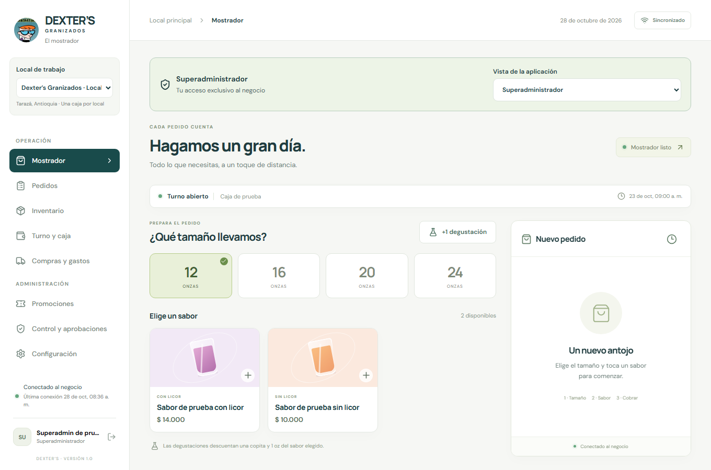
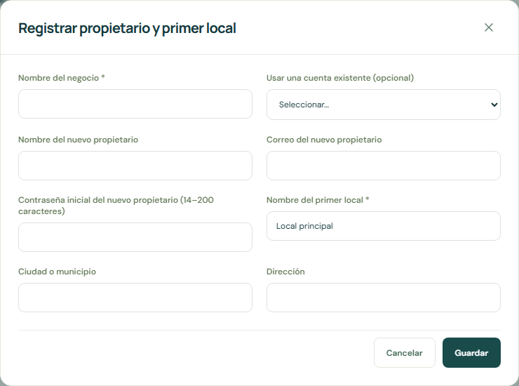
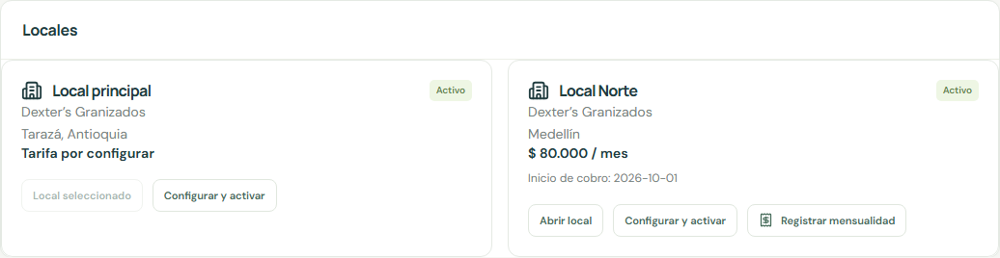
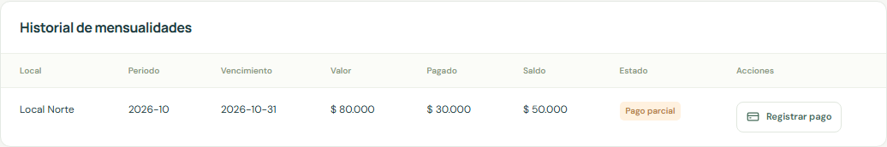

# Manual de usuario del superadministrador

Dexter’s Granizados

Guía para el desarrollador que administra propietarios locales accesos y mensualidades del servicio

Versión del manual 1 | 28 de octubre de 2026

Este manual explica el acceso privado del desarrollador, la gestión de negocios y locales, las mensualidades manuales y la supervisión de la operación. Su objetivo es permitirte incorporar propietarios, activar sucursales, registrar cobros y pagos y atender incidencias conservando la identidad y la información de cada local.

La aplicación se abre en https://dexter-granizados.vercel.app. La cuenta de superadministrador entra desde **Administrador** y se identifica mediante el acceso privado previamente reservado. El propietario y los administradores del negocio no pueden concederse este privilegio desde la aplicación.

El manual de administradores y empleados acompaña este documento con el detalle de ventas, inventario, compras y caja. Aquí se explica cómo supervisar esos procesos desde tu acceso y cuáles reglas siguen aplicándose.

## 1 Alcance del superadministrador

El superadministrador representa al desarrollador de la plataforma. Puede consultar los locales disponibles, registrar propietarios, revisar solicitudes de nuevos locales, configurar tarifas, activar o cambiar el estado del servicio y llevar el registro manual de mensualidades y pagos. También puede trabajar sobre la operación de un local con su identidad real y cambiar de vista para consultar el funcionamiento de los roles.

| Cuenta o vista            | Alcance                                                                                        |
| ------------------------- | ---------------------------------------------------------------------------------------------- |
| Superadministrador        | Gestión de propietarios locales y mensualidades y acceso a la operación del local seleccionado |
| Administrador propietario | Operación administrativa de su negocio solicitud de locales y consulta de sus mensualidades    |
| Administrador del equipo  | Administración del local asignado sin convertirse automáticamente en propietario               |
| Encargado de caja         | Operación y cobro de su turno desde el equipo autorizado                                       |
| Apoyo de mostrador        | Pedidos entregas y tareas permitidas con conexión sin cobro                                    |

El privilegio del desarrollador no representa varias personas. La identidad registrada en los cambios sigue siendo la tuya. Los tres votos que exige una salida administrativa corresponden a tres administradores distintos, y las anulaciones mantienen sus restricciones de participación en la venta.

La gestión del servicio no ejecuta cobros bancarios, no verifica transferencias con un banco y no emite facturación electrónica. Los registros de mensualidades permiten controlar importes y saldos del servicio por local.

## 2 Acceso privado y recuperación

### Activación inicial

El acceso privado se prepara fuera de las pantallas normales del negocio y se activa mediante un enlace reservado de un solo uso. Si la cuenta ya está activa, utiliza el ingreso habitual; no repitas la preparación inicial.

1. Abre el enlace privado en el navegador previsto. El enlace de activación tiene vencimiento y no debe compartirse con el cliente o los empleados.
2. Completa nombre, correo reservado y una contraseña de 14 a 200 caracteres.
3. Configura el doble factor con una aplicación de autenticación y completa la verificación.
4. Entra y comprueba que aparece la barra **Superadministrador** y el selector **Vista de la aplicación**.

Este acceso no exige registrar un equipo de caja, ni un código de dispositivo ni un PIN offline. La sesión se reconoce mediante la autenticación y el doble factor. El contexto de auditoría no se ofrece como un equipo físico que puedas convertir en caja principal.

### Ingresos posteriores

1. Abre la aplicación y elige **Administrador**.
2. Ingresa el correo reservado y tu contraseña.
3. Completa el código del autenticador.
4. Comprueba el perfil, el local de trabajo y la vista seleccionada.

No hay una opción pública separada para que una persona se registre como superadministrador. Crear un usuario con rol Administrador desde Equipo y accesos tampoco concede este acceso.

### Recuperar la contraseña

Utiliza **Administrador → Olvidé mi contraseña** o **Recuperar mi contraseña** desde el perfil. Abre el enlace recibido, verifica el doble factor existente y confirma una contraseña nueva. La recuperación no elimina el MFA ni cambia el privilegio reservado.

Si el enlace venció, solicita otro. Si el correo no llega o se perdió el autenticador, trata el caso con el procedimiento técnico correspondiente. No desactives controles de otros usuarios ni compartas credenciales para eludir la autenticación.

El acceso privado requiere conexión y MFA. Su privilegio no se conserva en el respaldo offline del navegador. Para salir, utiliza el botón del perfil; si tu usuario tiene operaciones pendientes, consérvalas y vuelve con la misma identidad para sincronizar.

## 3 Local de trabajo y vistas de la aplicación

### Seleccionar el contexto correcto

El selector **Local de trabajo** muestra negocio y local. Antes de cambiar precios, ver una venta o registrar dinero, comprueba ambos. Caja, turnos, catálogo, personal, existencias y documentos operativos se consultan por el local seleccionado.

El cambio de local requiere conexión y que terminen sincronización, conflictos y fotografías pendientes de tu usuario. Si aparece una espera, resuelve primero el estado de sincronización. Las distintas pestañas pueden trabajar sobre locales diferentes; no deduzcas el contexto de una pestaña a partir de otra.

Un local pendiente, suspendido o archivado conserva su información de consulta, pero bloquea las nuevas operaciones del local. La gestión de activación y mensualidades se realiza desde el panel de plataforma.

### Vista Superadministrador

Es la vista para gestionar la plataforma. Entra en **Locales y mensualidades** para ver propietarios o negocios, locales, tarifas, cobros y pagos. Puedes filtrar por negocio. Los importes de la pantalla se presentan en pesos colombianos enteros.

### Vista Administrador

En **Vista de la aplicación**, selecciona **Administrador** para usar la operación administrativa del local. Puedes agregar sabores y cambiar precios, parámetros, promociones o metas sin esperar aprobación de otro administrador. Los cambios mantienen tu identidad real; no se realizan a nombre de una cuenta del cliente.

Esta vista no representa un cambio de propietario ni una nueva sesión. Para la gestión global de plataforma, vuelve a **Superadministrador**.

### Vistas Encargado de caja y Apoyo de mostrador

Estas vistas son de consulta. Adaptan la presentación a esos roles y permiten recorrer pantallas o abrir formularios, pero bloquean el guardado. No se utilizan para cobrar ni para simular una venta real a nombre de un empleado. Para operar con un rol de empleado durante una capacitación, utiliza una cuenta y un entorno de ensayo autorizados.

Cuando existe un encargado del turno, la vista procura mostrar su contexto. Si no existe una persona equivalente, la presentación puede ser genérica. Esto no crea una cuenta ni asigna un turno a otra persona.

Termina y sincroniza pendientes antes de cambiar de vista. Usa **Volver a superadministrador** para recuperar la vista completa. Al cambiar se descartan formularios de la vista anterior; al recargar se vuelve a la vista principal.

## 4 Registrar un propietario y su primer local

El modelo de uso es **cuenta propietaria → negocio → uno o varios locales**. La misma persona puede administrar varias sucursales con su cuenta y consultar la mensualidad de cada una. El equipo operativo de una sucursal no obtiene por ello acceso a todas las demás.

### Usar una cuenta existente

1. En vista Superadministrador abre **Locales y mensualidades**.
2. Pulsa **Registrar propietario**.
3. Escribe el **Nombre del negocio**.
4. En **Usar una cuenta existente**, selecciona al administrador que será propietario.
5. Completa nombre del primer local, ciudad o municipio y dirección.
6. Guarda y revisa el negocio y su primer local pendiente de activación.

No completes los datos de nueva cuenta cuando utilizas una existente. La cuenta del propietario conserva su identidad y acceso; no necesita otro correo por cada sucursal.

### Crear una cuenta nueva

1. Abre el mismo formulario y deja seleccionada la creación de una cuenta nueva.
2. Completa negocio, nombre del nuevo propietario, correo y contraseña inicial de 14 a 200 caracteres.
3. Completa nombre y ubicación del primer local.
4. Guarda y verifica que se creó el propietario con su primer local pendiente.
5. Comunica el acceso por el canal autorizado, sin incluir contraseñas en capturas o documentos compartidos. La persona ingresará por Administrador y deberá completar el doble factor y el registro de su navegador cuando se solicite.

El correo reservado al superadministrador no puede utilizarse como una cuenta ordinaria del negocio. Si una cuenta ya existe, utiliza la selección de cuenta existente en lugar de intentar crear otra con el mismo correo.

El formulario crea un negocio con un primer local pendiente, pero no configura ni cobra automáticamente una mensualidad. Antes de la operación debes revisar y activar el local.

### Información inicial del local

Los locales nuevos tienen operación vacía y una lista inicial de tamaños y precios de referencia. No heredan inventario, ventas, personal operativo ni saldos de otro cliente. Su propietario deberá completar catálogo, recetas, existencias y equipo antes de vender.

El negocio anterior a la ampliación se conserva como **Local principal**, activo. Su tarifa e inicio de cobro permanecen por configurar hasta que los definas; la migración no crea deudas históricas.

## 5 Revisar solicitudes y activar locales

El propietario solicita sucursales desde **Locales y mensualidades → Solicitar local**. Solo puede solicitar para sus negocios. Tú también puedes registrar una solicitud desde el panel, eligiendo el negocio correcto.

### Procedimiento de activación

1. Revisa la tarjeta del local con estado **Pendiente de activación**.
2. Verifica negocio propietario, nombre, ciudad y dirección para no activar una sede equivocada.
3. Pulsa **Configurar y activar**.
4. Revisa nombre y ubicación y selecciona estado **Activo**.
5. Escribe la **Mensualidad por este local en COP** y la fecha de **Inicio de cobro**.
6. Guarda y comprueba estado, tarifa e inicio en la tarjeta.
7. Informa al propietario que puede seleccionar el local y prepararlo para la operación.

La tarifa puede ser **0** para una exención explícita. **Tarifa por configurar** significa que aún no se definió, y no debe interpretarse como una exención acordada. Para activar un local nuevo se requieren tarifa e inicio de cobro.

### Estados del local

| Estado                  | Qué permite y cuándo utilizarlo                                                 |
| ----------------------- | ------------------------------------------------------------------------------- |
| Pendiente de activación | Existe la solicitud y se consulta su información pero no se opera               |
| Activo                  | Admite la operación del local según los roles y permite registrar mensualidades |
| Suspendido              | Conserva el histórico de consulta y bloquea nuevas operaciones del local        |
| Archivado               | Conserva la información de un local fuera de operación                          |

Para suspender o archivar, cierra y sincroniza los turnos solicitados, abiertos o provisionales. La aplicación bloquea el cambio si encuentra uno. Coordina la revisión de equipos y pendientes antes de hacerlo: un dispositivo desconectado no recibe cambios remotos hasta reconectarse.

No hay eliminación del histórico ni suspensión automática por mora. Tú decides el cambio de estado y lo registras desde **Configurar y activar**. Para reactivar, revisa las condiciones, selecciona Activo y guarda; comprueba tarifa e inicio.

### Cambiar una tarifa

Edita la mensualidad en la tarjeta del local y guarda. Los cobros ya registrados conservan su importe. Los cobros que registres después toman la tarifa configurada en ese momento, incluso si se trata de un periodo que todavía no habías registrado. Revisa por ello la tarifa antes de incorporar meses pendientes.

No cambies de propietario a un local editando su nombre. El formulario permite configuración y estado, pero no ofrece una transferencia de propiedad. Si se necesita esa modificación, debe tratarse como un procedimiento técnico específico y revisado.

## 6 Registrar mensualidades por local

Las mensualidades se llevan de forma manual. La aplicación no genera cargos por sí sola al cambiar de mes y no retira dinero de las cuentas del propietario. Cada registro corresponde a **un local y un mes calendario completo**, sin prorrateo automático.

### Antes de registrar el periodo

Comprueba que el local está activo, tiene tarifa e inicio de cobro y que el periodo no es anterior al mes de inicio. Revisa si la mensualidad del periodo ya existe, así como pagos, ajustes de tarifa y cualquier acuerdo que debas reflejar antes del registro.

### Crear el registro

1. En la tarjeta correcta, pulsa **Registrar mensualidad**.
2. Selecciona el **Mes a cobrar**.
3. Indica la **Fecha límite de pago**, que no puede ser anterior al periodo.
4. Guarda y revisa la fila en **Historial de mensualidades**.
5. Confirma local, periodo, valor, vencimiento y saldo.

Solo existe un registro por local y mes. Repetir una solicitud del mismo periodo devuelve el registro existente; no crea otro ni cambia automáticamente el vencimiento o importe ya guardados. Para otro local, el mismo mes constituye un cobro independiente.

**Ejemplo.** Una persona tiene Local Centro con tarifa de $80.000 y Local Norte con tarifa de $100.000. Al registrar octubre en ambos, aparecen dos mensualidades, por un total registrado de $180.000. Esto no representa un cargo ejecutado contra el banco ni prueba que se recibió un pago.

Si el inicio es el 20 de octubre, el primer periodo admitido es octubre completo. No se calcula una fracción de once días. Define las condiciones con el propietario y configura la tarifa correspondiente antes de registrar el cobro.

### Leer el resumen

El panel muestra locales activos, solicitudes pendientes, suma de tarifas de los activos y saldo pendiente de cobros registrados. La suma mensual de tarifas puede incluir un local que todavía no tiene una mensualidad registrada para el mes; no debe confundirse con dinero recibido.

Un local con tarifa sin configurar aporta una condición pendiente de definir. El saldo pendiente suma los cobros vigentes menos sus pagos; las mensualidades anuladas no aportan deuda. El filtro por negocio permite revisar una cuenta propietaria sin mezclarla con las demás.

## 7 Registrar pagos y consultar saldos

### Registrar un pago recibido

1. Verifica por el medio correspondiente que recibiste el dinero y a qué local y periodo pertenece.
2. Busca la mensualidad y pulsa **Registrar pago**.
3. Indica **Valor recibido en COP**, **Fecha del pago** y **Referencia o comprobante**.
4. Guarda una sola vez y comprueba que el importe aparece en **Pagos recibidos** y reduce el saldo de la mensualidad correcta.

Se permiten abonos parciales. El pago debe ser positivo y no superar el saldo pendiente. El identificador de la operación evita duplicarlo cuando se reintenta la misma solicitud. El mismo identificador no puede reutilizarse con datos diferentes.

**Ejemplo.** Una mensualidad de $80.000 recibe un abono de $30.000. Pagado será $30.000 y el saldo $50.000. Un segundo pago de $50.000 completa el periodo. La aplicación no admite un segundo pago de $60.000 sobre ese saldo.

La referencia es un campo de texto; este formulario no ofrece una carga de foto del comprobante bancario. Registra una referencia verificable y conserva el soporte por el procedimiento del negocio. No introduzcas datos confidenciales completos de una cuenta o tarjeta en ese texto.

### Pago que cubre varios locales o meses

Si un propietario envía un solo monto para varias mensualidades, distribúyelo en registros separados de las mensualidades correspondientes. Puedes usar la misma referencia bancaria con una descripción que identifique la distribución. Comprueba que la suma de registros coincida con el dinero real recibido.

La aplicación no reparte automáticamente un pago entre locales o meses. Registrar todo en el primer local dejaría deuda en los demás o superaría su saldo. Evita duplicar el importe total al usar una referencia en varias filas.

### Estados de una mensualidad

| Estado       | Interpretación                                          |
| ------------ | ------------------------------------------------------- |
| Pendiente    | Tiene saldo y no registra pagos ni está vencida         |
| Pago parcial | Tiene abonos y saldo pendiente antes del vencimiento    |
| Pagada       | El saldo es cero                                        |
| Vencida      | Tiene saldo y pasó la fecha límite de pago              |
| Anulada      | Se anuló el registro sin pagos conservando el histórico |

Una mensualidad con abonos también se muestra vencida si pasó su fecha límite y aún tiene saldo. **Pagada** describe la suma de registros manuales; no reemplaza la comprobación del dinero recibido.

### Información visible para el propietario

El propietario puede consultar las mensualidades y pagos de sus negocios, pero no registra pagos ni modifica tarifas o cobros. Si reporta un pago ausente, verifica local, periodo, fecha, monto y referencia antes de incorporarlo. El equipo operativo de un local no obtiene acceso global a tus clientes.

## 8 Anulaciones y correcciones de cobros del servicio

En una mensualidad sin pagos aparece **Anular**. Escribe un motivo concreto de al menos tres caracteres y guarda. El registro permanece en el histórico y deja de aportar saldo pendiente.

El periodo de esa mensualidad queda reservado incluso después de anularla. No existe un segundo cobro independiente del mismo local y mes. Anular no es un mecanismo para volver a emitir libremente el periodo con otro valor.

No puedes anular una mensualidad con pagos registrados. Los pagos y su auditoría son inmutables. Esta versión no ofrece botones para editar o eliminar un pago, registrar un abono negativo, devolver dinero del servicio o reemitir un periodo anulado.

Ante un pago imputado al local equivocado o un periodo cuyo valor requiere corrección, conserva referencias y soportes y prepara la resolución técnica o administrativa correspondiente. No registres otro pago ficticio ni una venta del mostrador para compensar un error de mensualidad.

La tarifa editada se utiliza para nuevos registros; no altera los importes ya guardados. Si la mensualidad ya existe, repetir su creación no corrige su valor o su fecha. Revisa por ello los datos antes de confirmar cada registro.

## 9 Administración de la operación de un local

Como superadministrador puedes acceder a la operación del local seleccionado. Para trabajo de administración habitual puedes usar la vista Administrador. Aplica los procedimientos detallados del manual de administradores y empleados y conserva estas condiciones.

### Catálogo parámetros y metas

En **Configuración**, administra sabores, presentaciones y receta, precios, disponibilidad, límites de caja y gastos, cuota de cortesías, referencias de paquetes y bolsas, tolerancia de líquido, sincronización, listas de apertura y cierre, metas e histórico.

El guardado administrativo es directo y conserva tu usuario. Los cambios se aplican al local seleccionado; no existe una publicación de catálogo que actualice automáticamente a todos los clientes. Comprueba el resultado y evita cambiar configuraciones mientras se atiende un pedido sin coordinar con el responsable.

### Usuarios y dispositivos

En **Equipo y accesos**, crea administradores o empleados del local, activa o desactiva accesos y registra equipos de empleados con códigos temporales. El dispositivo principal se define por local y solo se cambia sin un turno activo que lo impida.

Tu contexto privado no aparece como equipo de caja del negocio y no se puede convertir en dispositivo principal. La aplicación mantiene el acceso del propietario y al menos un administrador activo. El panel de negocio no puede asignar, modificar ni revocar tu privilegio privado.

### Caja y responsabilidad de cobro

Con conexión puedes **Iniciar caja** a tu propio nombre, presentar conteos, cobrar y cerrar ese turno, igual que un administrador autorizado. No necesitas que otra persona autorice tu apertura, pero debes cumplir el conteo y las demás condiciones.

No puedes cobrar el turno de otro usuario por ser superadministrador. Solo hay un turno solicitado, abierto o provisional a la vez por local. Coordina el cierre del responsable antes de abrir uno tuyo; no uses esta función en el local real para una demostración con ventas ficticias.

### Pedidos y correcciones

Revisa tickets, entregas, origen en papel y datos asociados. Para una venta cobrada con error se solicita anulación con evidencia y la aprueba una persona ajena a la venta y su cobro. Después se crea el ticket sustituto o se realiza el reembolso que admita el flujo.

Tu cuenta no omite la restricción sobre la venta propia. El pago anterior se vincula al sustituto y las entregas deben indicar si se conserva el producto físico. Evita duplicar consumos o movimientos al corregir.

### Inventario compras y recepciones

Revisa saldos teóricos, negativos, bolsas, paquetes, degustaciones y merma aprobada. El inventario inicial se registra una sola vez; después se utilizan recepciones y movimientos reales. Una tolerancia de líquido genera control y no descuentos al empleado.

En Compras y gastos, registra envíos y revisa las recepciones físicas, daños y diferencias. La recepción incorpora unidades utilizables: diez recibidas con dos dañadas agregan ocho útiles. La persona que recibe registra lo físico sin tomar el esperado como respuesta.

### Gastos traslados y autorizaciones

Revisa gastos y sus soportes. Una salida física de caja pendiente de aprobación no debe repetirse como otro pago. En movimientos de dinero distingue solicitud, ejecución, tránsito y confirmación por el receptor.

Las utilidades y reembolsos administrativos de gastos requieren tres administradores distintos y un ejecutor diferente del beneficiario. Ser superadministrador no convierte un voto en tres ni confirma por el receptor. El reembolso de un ticket al cliente es un flujo separado.

### Promociones y cupones

Puedes crear beneficios de precio fijo, upgrade, lleva N y paga M y producto gratis con cupón, con vigencias, elegibilidad y límites. Los cupones se consumen al confirmar un cobro válido conectado. Las cortesías adicionales requieren otra persona cuando se supera la cuota.

Mantén separada una promoción del negocio de un ajuste de mensualidad del servicio. Un cupón del mostrador no paga ni reduce una mensualidad de plataforma.

## 10 Incidencias sincronización y auditoría

### Investigar una incidencia

1. Solicita local, usuario, pantalla, hora aproximada, ticket o referencia de operación y mensaje exacto.
2. Pregunta qué ocurrió físicamente: dinero recibido o devuelto, producto entregado, mercancía recibida o pérdida.
3. Averigua si hay registros y fotografías pendientes en el equipo original.
4. Selecciona el local y revisa Pedidos, Turno y caja, Compras y gastos o Control, según el caso.
5. Decide el procedimiento de corrección y conserva los registros originales y soportes.

Una captura de pantalla o una referencia no debe incluir contraseñas, PIN, códigos de autenticación ni enlaces privados de activación. El acceso técnico no justifica copiar datos de otro propietario para resolver un caso.

### Operaciones por conciliar

Un conflicto detiene la cola del equipo en ese punto. Pide conservar el navegador y exportar su respaldo local de pendientes. No aconsejes borrar datos o reinstalar antes de recuperar lo que todavía no llegó al servidor.

En **Control y aprobaciones**, revisa la solicitud de sincronización. Si la operación física ocurrió, registra primero la operación correcta con sus soportes y vincúlala como sustituta con explicación. Si corresponde descartarla, deja el motivo. Después solicita al usuario que vuelva a sincronizar y verifique que la cola continúa.

No vuelvas a cobrar una venta solo porque el equipo mostraba espera. Tampoco ingreses una planilla sin comprobar si el pedido original aún puede sincronizarse, porque se podrían registrar dos ventas del mismo hecho.

### Arqueos y ventas en papel

El arqueo sorpresa bloquea pedidos, entregas y cobros hasta presentar el conteo. Si se sigue atendiendo en papel, se separa el efectivo posterior al corte, se conservan folios y luego se ingresan las ventas con su hora y evidencia. El conteo original queda intacto.

### Auditoría avisos y exportaciones

El rastro de auditoría del local muestra momento, acción, usuario y detalle de la operación. Los cambios de plataforma y los registros de pagos conservan su trazabilidad, pero no existe una pantalla independiente de consulta global de esa auditoría técnica en este panel.

Los avisos externos dependen de la configuración del local. Los destinos del local principal no se utilizan automáticamente para avisos de otros propietarios. Puedes revisar errores y solicitar reintentos desde Control; enviar un aviso no aprueba una operación.

Exporta el local desde Control cuando necesites archivos operativos. La exportación identifica su contexto y contiene CSV y diccionario. No debe confundirse con un respaldo técnico completo que incluya autenticación y fotografías. La aplicación no muestra aquí una descarga universal de bases de datos o un panel de recuperación completa.

### Qué continúa siendo una tarea técnica

La configuración del proveedor de correo, canales externos, alojamiento, respaldos automáticos y restauración, migraciones y recuperación del acceso privado se resuelve mediante los procedimientos técnicos del proyecto. No hay botones de usuario para todas esas acciones. Consulta la documentación de operación y respaldos del sistema antes de intervenir.

No se detalla en este manual ninguna clave privada o código vigente. La activación del superadministrador se prepara con el procedimiento reservado y nunca desde una cuenta administrativa del cliente.

## 11 Rutinas recomendadas para gestionar el servicio

### Incorporación de un nuevo propietario

- Confirmar identidad y correo y elegir cuenta nueva o existente.
- Registrar negocio y primer local pendiente.
- Verificar ubicación condiciones y tarifa de ese local.
- Activar con inicio de cobro definido y acompañar la configuración del catálogo inventario y personal.
- Comprobar que el propietario puede seleccionar el local y que el equipo opera con los permisos correctos.
- Registrar la mensualidad del periodo cuando corresponda y comprobar que se consulta en la cuenta propietaria.

### Revisión mensual

1. Filtra cada negocio y revisa locales activos, pendientes, suspendidos y archivados.
2. Confirma tarifa e inicio de cada local antes de registrar el periodo.
3. Revisa el historial para evitar omisiones o intentos de reemitir un periodo ya reservado.
4. Registra las mensualidades que correspondan y sus vencimientos.
5. Concilia los pagos reales, distribuyendo los que cubren varios locales o meses.
6. Revisa saldos y vencimientos y conserva las referencias que soportan cada registro.

La pantalla no envía automáticamente recordatorios de cobro ni suspende por falta de pago. Cualquier comunicación al propietario se realiza por el canal acordado y no debe darse por enviada al registrar la mensualidad.

### Antes de suspender o archivar

Coordina con el propietario, revisa los turnos y la sincronización del equipo, conserva las novedades e identifica el último estado operativo. Cambia el estado desde Configurar y activar y comprueba que el histórico sigue disponible y las nuevas operaciones se bloquean. El cambio de estado no borra una deuda ni anula sus mensualidades.

## 12 Preguntas frecuentes y límites de la pantalla

### Una persona tiene varios locales y quiere un solo acceso

Usa la misma cuenta como propietaria del negocio y solicita o registra sus locales dentro de ese negocio. Cada local conserva su operación y mensualidad. No crees una cuenta nueva por sucursal para resolver la selección de locales.

### No aparece Locales y mensualidades

Comprueba que estás en la cuenta privada correcta y en vista Superadministrador. Si estabas consultando Encargado o Apoyo, vuelve a Superadministrador. Actualiza la aplicación cuando exista aviso y ya no haya turno ni registros pendientes que lo impidan.

### No permite activar o suspender

Para activar, revisa tarifa e inicio de cobro. Para suspender o archivar, resuelve turnos solicitados, abiertos o provisionales del local. Si hay pendientes del equipo, trata la sincronización antes de continuar.

### Se cambió la tarifa pero el cobro anterior sigue igual

Es el comportamiento esperado: el importe ya registrado se conserva. Una tarifa nueva afecta los cobros que se registren después, no recalcula el historial.

### La mensualidad dice pagada y el banco no muestra ese dinero

El estado depende de registros manuales. Revisa quién registró, fecha, importe, referencia y mensualidad asociada. No existe verificación bancaria automática ni un botón para borrar el pago; conserva los datos e investiga la corrección por el procedimiento correspondiente.

### Se necesita reemitir una mensualidad anulada o cambiar de propietario

Esas acciones no tienen un flujo de pantalla en esta versión. No crees ventas, pagos ficticios o negocios duplicados para simular el ajuste. Reúne el caso y define una intervención técnica específica que conserve la trazabilidad.

### Quiero probar el rol de empleado

Las vistas de Encargado y Apoyo de tu cuenta son de consulta. Utiliza esas vistas para explicar pantallas y permisos. Las pruebas con cambios se realizan con cuentas y datos de ensayo separados de la operación real.

### Diferencia entre mensualidad venta traslado y utilidad

La mensualidad corresponde al servicio de la aplicación por local. La venta es el cobro de productos al cliente. Un traslado mueve dinero del negocio entre ubicaciones y una utilidad es una salida con sus aprobaciones. Registra cada hecho en su módulo; mezclar estos conceptos produce saldos incorrectos.

Conserva este manual junto con el de administradores y empleados. Para una atención de soporte, parte de la situación física y de los registros del local, identifica la regla aplicable y verifica el resultado antes de dar el caso por resuelto.
